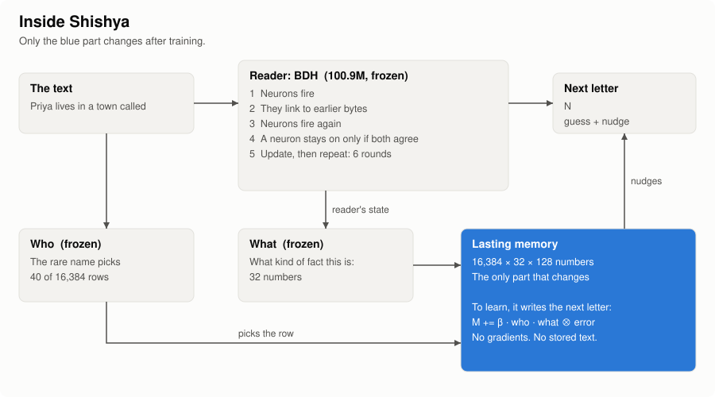
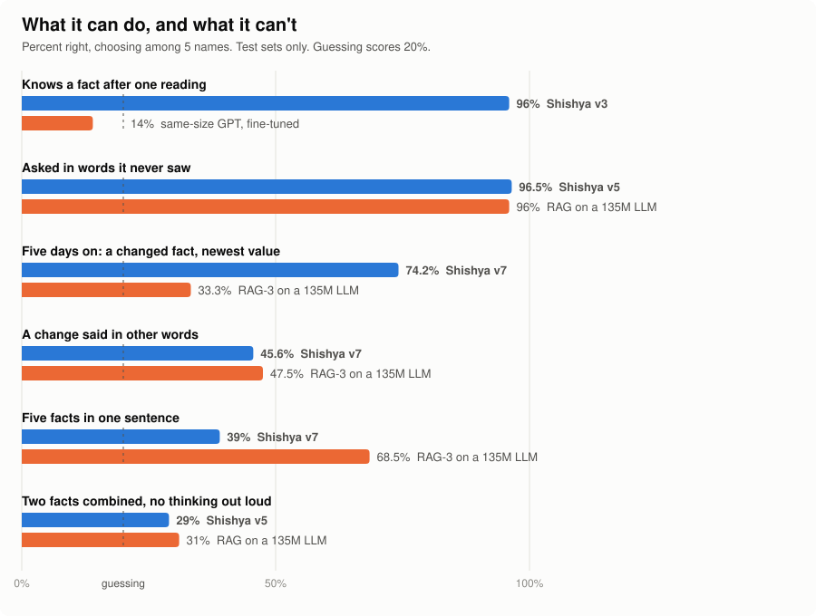

<div align="center">

# Shishya

### A neural network that keeps learning after training.

It reads a sentence once and knows it. No retraining, and no notes kept on the side.

[](https://github.com/sanattaori/shishya/actions/workflows/ci.yml)
[](LICENSE)
[](https://colab.research.google.com/github/sanattaori/shishya/blob/main/brain/demo.ipynb)

**[Interactive guide: see how it works, with things you can click](https://sanattaori.github.io/shishya/)**

[Architecture](#the-architecture) · [Results](#results) · [What surprised us](#what-surprised-us) · [Timeline](#what-we-did) · [Try it](#try-it) · [Full report](docs/RESEARCH.md)

</div>

## The idea

Language models stop learning when training ends. There are two usual fixes:

- **Train again.** This is slow, and it damages what the model already knew.
- **Keep the text and paste it back in (RAG).** This works well, but the model itself has learned nothing.

Shishya tries a third way, closer to a brain: **reading a fact changes lasting connections inside the model.**

Picture someone who already speaks English and carries a notebook. The language never changes. Only the notebook does.
After one reading, Shishya scores 96%, where a same-size GPT, fine-tuned, scores 14%.

## The architecture

<picture>
  <source media="(prefers-color-scheme: dark)" srcset="docs/img/architecture-dark.svg">
  
</picture>

| Part | What it does | Changes after training? |
|---|---|---:|
| **Reader** | A language model that already knows English | No |
| **Who** | The rare name picks 40 of the memory's 16,384 rows | No |
| **What** | The meaning picks a spot in those rows | No |
| **Lasting memory** | A fixed block of numbers that holds what it learned | **Yes. This is the learning.** |

### How it learns

Say it reads *"Priya lives in a town called Nashik."*

1. "Priya" is new to it, so the sentence is worth keeping, and the name picks the rows.
2. The reader's sense of "a town comes next" picks the spot.
3. It writes the next letter there, harder when it is more surprised.

The whole learning rule fits on one line, with no gradients and no optimiser:

```text
M[row] += strength · who(row) · what ⊗ (next letter − what the memory says now)
```

This comes from **Hebbian learning**, the brain's "fire together, wire together": a connection changes using only what it
can see locally, with no error signal sent back through the whole network. Ours also corrects itself, writing only the
difference from what it already holds. This is called the **delta rule**.

### How it answers

Ask *"The town where Priya lives is called"*. The name opens the same rows. The words are different, but the meaning is
close, so it finds a nearby spot. What is stored there nudges the next letter towards **N**, then **a**, then **s**.

There's no database and no search. The answer is the reader's normal guess, nudged by the memory.

### Inside the reader: BDH

The reader is [BDH](https://arxiv.org/abs/2509.26507), Pathway's brain-like language model. Where GPT passes dense lists
of numbers around, BDH passes **65,536 neurons that fire or stay silent**.

1. **Neurons fire.** Each byte switches on some neurons, and the rest stay silent.
2. **They link to the past.** Where the same neurons fired on an earlier byte, a temporary link forms.
3. **Neurons fire again,** this time from that context.
4. **Both must agree.** A neuron stays on only if steps 1 and 3 both fired it.
5. **Update and repeat.** The same weights run 6 rounds, like one brain thinking 6 times.

Those links vanish when the text ends, so BDH remembers nothing afterwards. **Shishya adds the part that lasts.**

Want more? The [interactive guide](https://sanattaori.github.io/shishya/) steps through this, and the
[full architecture](docs/ARCHITECTURE.md) has the shapes, equations and code.

## Results

The pass rules were fixed before each run. Each question is a choice among 5 names, so guessing scores 20%.

<picture>
  <source media="(prefers-color-scheme: dark)" srcset="docs/img/research-dark.svg">
  
</picture>

**What works**
- After one reading it scores 96%. A same-size GPT, fine-tuned, scores 14%.
- It scores 96.5% on wordings it never saw, about kinds of fact it never trained on.
- Over five days, with its memory saved and reloaded each day, it kept 88% of its unchanged facts.

**What doesn't work yet**
- A change said in new words often doesn't replace the old fact.
- Several facts in one sentence blur together.
- It can't combine two facts unless it thinks out loud.

**Should you use this instead of RAG? Not today.** RAG ties or beats it on most tests. RAG's text is also far smaller:
under 1 MB, against a fixed 268 MB. And Shishya has only been tested on made-up names in simple sentences. This is
research, not a product. [The report](docs/RESEARCH.md#limits-of-this-work) lists every limit we know of.

## What surprised us

1. **Where you write matters more than the network.** The same network, with only a new way to choose where facts are
   stored, went from 67% to 99%.
2. **One idea fixed other wordings.** Splitting the address into *who* and *what* took unseen wordings from 35% to 96.5%.
3. **A model eight times bigger didn't fix the hard problem.** It understood kinds of fact much better, yet updating facts
   didn't improve. The limit is in the memory.
4. **Sleep made it worse.** Replaying memories, as a brain does in sleep, protected old facts but brought old values back.
5. **Forgetting isn't the same as updating.** Protecting stored facts stopped all forgetting, and then new values won only
   3% of the time.
6. **We often guessed wrong.** We predicted 45–65% for one test, and it scored 98%. Writing guesses down first is how we
   know.

## What we did

Eight versions in nine days, on free hardware.

| Date | What we tried | Result |
|---|---|---|
| 31 Oct | **v1, v2:** BDH plus lasting connections | Fail. Recall 35%, then 67%, and it lost old facts |
| 31 Oct | **v3:** choose where to write by the sentence's rare words | 99%, and 96% after one reading. Failed only on speed |
| 1 Nov | **v4 and a hybrid on a real LLM.** Also tried two ideas from IBM's Larimar | Fail. Other wordings stuck at 27–35%. The final model doesn't use Larimar's ideas |
| 2 Nov | **v5:** separate *who* from *what* | **All rules pass.** Other wordings 89.5–96.5% |
| 2 Nov | **A harder exam, then v6:** changing facts, five facts in one sentence | Fail, 19–49%. But a five-day life passes |
| 3 Nov | **v7:** a 100M reader, plus sleep | Fail. Changes 46%. The five-day life passes again |
| 3 Nov | **Side study:** a 270 KB layer that gives a frozen LLM habits | Mixed. Each habit passes alone; real trivia fails |
| 3–4 Nov | **v8 tests:** a free LLM restates sentences before they're stored | Fail by one question. Changes 69%, needing 70% |
| 4 Nov | **v8, latest:** hide replaced values | Fail by two questions. Changes 85%, the best yet, but unchanged facts 81%, needing 85% |

Before this, from 27 to 29 Oct, the project was a small rules library. It's [still here](docs/DECISIONS.md).

## How we kept it honest

- **Rules first.** Each plan, pass rule and prediction was committed before its run. A version one question short still
  fails.
- **Failures stay.** Most versions failed, and all of them are [on the record](docs/RESEARCH.md#every-version).
- **Numbers you can check.** The raw outputs are in [`brain/results/`](brain/results/).

## Try it

**In your browser:** the [interactive guide](https://sanattaori.github.io/shishya/#demo) ends with a small toy you can teach.
It's a tiny version to show the idea, and it isn't the real model.

**The real model** runs on a normal CPU, with no GPU or API key. The first run downloads a free 400 MB model.

```bash
git clone https://github.com/sanattaori/shishya && cd shishya
pip install torch numpy huggingface_hub

python -m brain.teach --tour      # what it can do, and what it can't
python -m brain.teach             # teach it yourself
```

```text
> Zubak has a dog named Rex.      a line ending in "." is taught
> The name of Zubak's dog is      anything else is a sentence for it to finish
```

Use rare names, and expect a few seconds per letter. Only the unfinished sentence goes in, so the answer can only come
from its memory. The red lines are real failures, and we left them in.

<picture>
  <source media="(prefers-color-scheme: dark)" srcset="docs/img/teach-dark.svg">
  
</picture>

## Find your way around

| Where | What |
|---|---|
| [Interactive guide](https://sanattaori.github.io/shishya/) | The easiest place to start |
| [`docs/ARCHITECTURE.md`](docs/ARCHITECTURE.md) | How it works, in plain words and in full detail |
| [`docs/RESEARCH.md`](docs/RESEARCH.md) | The report: results, lessons, limits and open problems |
| [`docs/README.md`](docs/README.md) | A guide to every document |
| [`brain/v5.py`](brain/v5.py) | The memory: address, read, write and training |
| [`lab/`](lab/) | A side study: a 270 KB layer that gives a frozen LLM habits |
| [`shishya/`](shishya/) | A separate library: the most likely answer that breaks no rule. [Docs](docs/DECISIONS.md) |

**Want to help?** The [open problems](docs/RESEARCH.md#open-problems) are small, clear experiments. See
[CONTRIBUTING](CONTRIBUTING.md).

## Credits

Built on [BDH](https://arxiv.org/abs/2509.26507) by Pathway ([code](https://github.com/pathwaycom/bdh), MIT) and the free
[100M BDH](https://huggingface.co/d3vmeh/bdh-100m-bytes) model. Baselines use
[SmolLM2](https://huggingface.co/HuggingFaceTB/SmolLM2-135M). Training uses
[TinyStories](https://huggingface.co/datasets/roneneldan/TinyStories).

*Shishya* (शिष्य) is Sanskrit for "student": one who learns from a *guru*.

## Citation

```bibtex
@misc{taori2026shishya,
  author = {Taori, Sanat},
  title  = {Shishya: a neural network that keeps learning after training},
  year   = {2026},
  url    = {https://github.com/sanattaori/shishya}
}
```

Licensed under [Apache-2.0](LICENSE).
