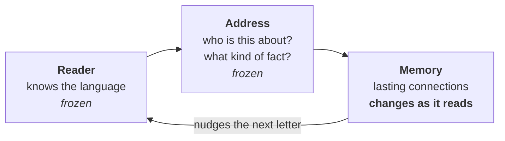

<div align="center">

# Shishya

### A neural network that keeps learning after training.

It reads a sentence once and knows it. No retraining, and no notes kept on the side.

[](https://github.com/sanattaori/shishya/actions/workflows/ci.yml)
[](LICENSE)
[](https://colab.research.google.com/github/sanattaori/shishya/blob/main/brain/demo.ipynb)

**[Try it](#try-it)** · **[How it works](#how-it-works)** · **[Results](#results)** · **[Full report](docs/RESEARCH.md)**

</div>

<picture>
  <source media="(prefers-color-scheme: dark)" srcset="docs/img/teach-dark.svg">
  
</picture>

Only the unfinished sentence goes in, so "Nashik" can only come from its memory. The network's weights don't change.
Only a separate block of lasting connections does, as it reads.

The red lines are real failures. We left them in.

## The idea

Language models stop learning when training ends. There are two usual fixes:

- **Train again.** This is slow, and it damages what the model already knew.
- **Keep the text and paste it back in (RAG).** This works well, but the model itself has learned nothing.

Shishya tries a third way, closer to a brain: **reading a fact changes lasting connections inside the model**, using a
simple local rule.

## Try it

It runs on a normal CPU. You don't need a GPU or an API key. The first run downloads a free 400 MB model.

```bash
git clone https://github.com/sanattaori/shishya && cd shishya
pip install torch numpy huggingface_hub

python -m brain.teach --tour      # what it can do, and what it can't
python -m brain.teach             # teach it yourself
```

```text
> Zubak has a dog named Rex.      a line ending in "." is taught
> The name of Zubak's dog is      anything else is a sentence for it to finish
```

Use rare names, and expect a few seconds per letter.

## How it works

There are three parts, and only one ever changes.



**To learn,** it reads a sentence. The rare name picks a place in the memory, and the meaning picks a spot there. It
writes the next letter at that spot, harder when it is more surprised.

**To answer,** the same name opens the same place, and a similar meaning finds a nearby spot, even in other words. What
is stored there nudges the next letter. The answer comes out one letter at a time.

There's no database and no search. **[Read the architecture](docs/ARCHITECTURE.md)**: plain words first, then the
shapes, equations and code.

## Results

The pass rules were fixed before each run. Each question is a choice among 5 names, so guessing scores 20%.

<picture>
  <source media="(prefers-color-scheme: dark)" srcset="docs/img/research-dark.svg">
  
</picture>

**What works**
- After one reading it scores 96%. A same-size GPT, fine-tuned, scores 14%.
- It scores 96.5% on wordings it never saw, about kinds of fact it never trained on.
- Over five days, with its memory saved and reloaded each day, it kept 88% of its unchanged facts.

**What doesn't work yet**
- A change said in new words often doesn't replace the old fact.
- Several facts in one sentence blur together.
- It can't combine two facts unless it thinks out loud.

**Should you use this instead of RAG? Not today.** RAG ties or beats it on most tests. RAG's text is also far smaller:
under 1 MB, against a fixed 268 MB. And Shishya has only been tested on made-up names in simple sentences. This is
research, not a product. [The report](docs/RESEARCH.md#limits-of-this-work) lists every limit we know of.

## How we kept it honest

- **Rules first.** Each plan, pass rule and prediction was committed before its run. A version one question short still
  fails.
- **Failures stay.** Eight versions, and most of them failed. All of them are [on the record](docs/RESEARCH.md#every-version).
- **Numbers you can check.** The raw outputs are in [`brain/results/`](brain/results/).

Want to help? The [open problems](docs/RESEARCH.md#open-problems) are small, clear experiments. Issues and pull requests
are welcome.

## Find your way around

| Where | What |
|---|---|
| [`brain/teach.py`](brain/teach.py) | The demo. Start here. |
| [`brain/v5.py`](brain/v5.py) | The memory: address, read, write and training |
| [`docs/ARCHITECTURE.md`](docs/ARCHITECTURE.md) | How it works, in plain words and in full detail |
| [`docs/RESEARCH.md`](docs/RESEARCH.md) | The report: results, lessons, limits and open problems |
| [`lab/`](lab/) | A side study: a 270 KB layer that gives a frozen LLM habits |
| [`shishya/`](shishya/) | A separate library: the most likely answer that breaks no rule. [Docs](docs/DECISIONS.md) |

## Credits

Built on [BDH](https://arxiv.org/abs/2509.26507) by Pathway ([code](https://github.com/pathwaycom/bdh), MIT) and the free
[100M BDH](https://huggingface.co/d3vmeh/bdh-100m-bytes) model. Baselines use
[SmolLM2](https://huggingface.co/HuggingFaceTB/SmolLM2-135M). Training uses
[TinyStories](https://huggingface.co/datasets/roneneldan/TinyStories).

*Shishya* (शिष्य) is Sanskrit for "student": one who learns from a *guru*.

## Citation

```bibtex
@misc{taori2026shishya,
  author = {Taori, Sanat},
  title  = {Shishya: a neural network that keeps learning after training},
  year   = {2026},
  url    = {https://github.com/sanattaori/shishya}
}
```

Licensed under [Apache-2.0](LICENSE).
