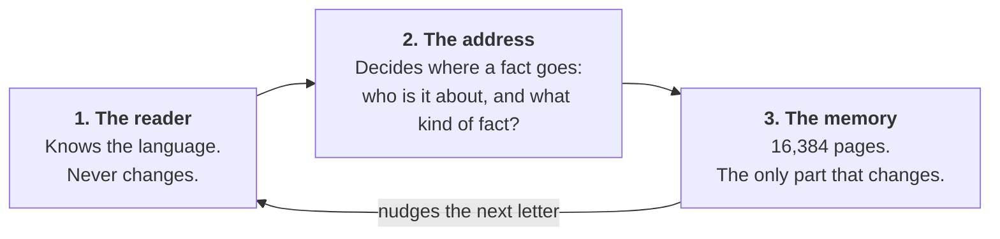
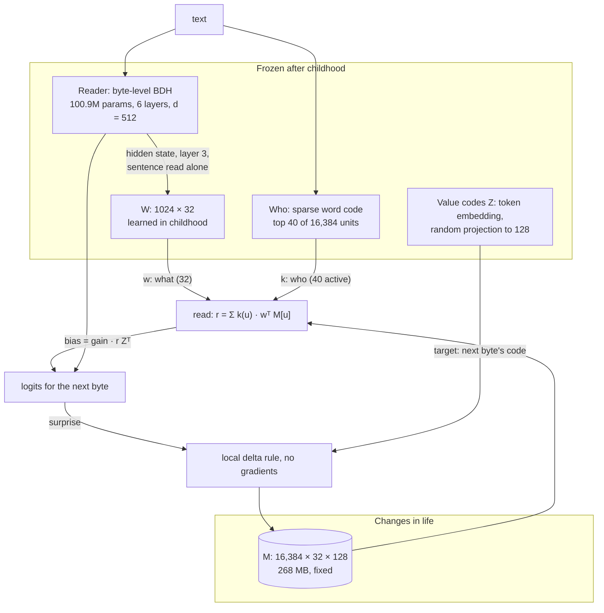
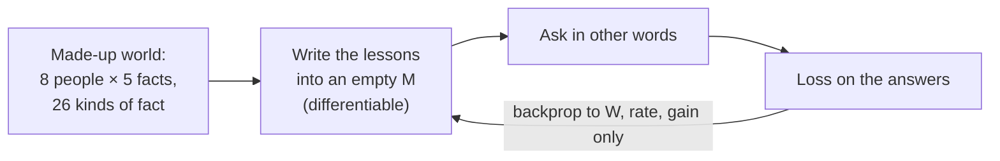
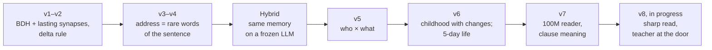

# How Shishya works

This page explains the model twice. [Part 1](#part-1-in-plain-words) uses plain words and needs no machine learning.
[Part 2](#part-2-the-engineering) gives the shapes, the equations and the code. [Part 3](#part-3-the-repository) is a
map of the repository.

It describes **v7**, the model behind the demo. How each version got here is in [RESEARCH.md](RESEARCH.md).

---

## Part 1: in plain words

### The problem

A normal language model stops learning the day training ends. Tell it a new fact and it forgets it at the end of the
chat. There are two usual fixes:

- **Train it again.** Slow, and it damages what the model already knew.
- **Keep the text and paste it back in (RAG).** This works well, but the model itself has still learned nothing. It is
  reading its notes.

Shishya tries a third way, closer to what a brain does: **reading a fact changes the connections inside the model.**
Nothing is trained, and no text is kept.

### The three parts

Think of a person who already speaks English and has a very odd notebook.



| Part | In plain words | Does it change after training? |
|---|---|---|
| **The reader** | A network that already knows how English goes. | Never. |
| **The address** | Two questions. *Who is this about?* picks the pages. *What kind of fact is this?* picks the spot on the page. | Never. |
| **The memory** | A fixed block of numbers. Think of it as the connections that last. | **Yes. This is the learning.** |

### Reading a sentence

Say it reads *"Priya lives in a town called Nashik."*

1. **It looks for a new word.** "Priya" is new to it, so this sentence is worth keeping. A sentence with only familiar
   words isn't stored at all. That is why "Marie" fails in the demo: it has met that name too often.
2. **"Priya" picks the pages.** The same name always picks the same 40 pages, however the sentence is worded.
3. **The meaning picks the spot.** The reader's sense of "this is where a town comes next" gives a position on those
   pages.
4. **It writes the next letter there.** N, then a, then s, and so on. How hard it writes depends on how surprised it
   was. An expected letter barely changes anything. A surprising one changes a lot.

That is all learning is here. It takes one reading, and no training runs.

### Answering a question

Now ask *"The town where Priya lives is called"*.

1. The name "Priya" opens the **same pages**.
2. The words are different, but the meaning is close, so it looks at **nearly the same spot**.
3. What it finds there pushes the next letter towards **N**. Then the same again for **a**, **s**, and so on.

It writes the answer one letter at a time. It has no database to look in. The answer is the reader's normal guess,
nudged by the memory.

### Where the skill comes from

The address has one trained piece: the map from "what the reader is thinking" to "what kind of fact this is". We train
it once, before life starts, on made-up people and **other** kinds of facts (teachers, boats, songs). We call this
**childhood**. It teaches the model how to use a memory, not any particular fact.

After childhood the training stops for good. Everything it learns later comes from the one simple writing rule.

### Why it fails where it fails

Once you see the notebook, the failures make sense.

| It fails when | Because |
|---|---|
| A change is said in new words: *"Priya moved to Pune."* | "Moved to" lands at a different spot than "lives in", so the old answer stays where the question looks. |
| One sentence holds five facts | The person's facts sit on the same pages, and five meanings at once blur together. |
| The name is common | It looks like nothing new, so nothing is stored. |
| Two facts must be combined, and it isn't allowed to think out loud | Each lookup finds one fact. Nothing links them. |

The next step we think would help is giving each kind of fact its own slot, called **roles**. It isn't proven yet.

---

## Part 2: the engineering

### System view



### Components

| Component | Shape | Parameters | Where |
|---|---|---|---|
| Reader: Pathway's BDH, MIT, SHA-256 checked | bytes → hidden `d = 512`, 6 layers | 100.9M, frozen | `brain/third_party/bdh.py`, `v5.BDHLM`, `v5.load_bdh` |
| Who | `k`: 40 of `U = 16,384` units, unit length | fixed code plus word counts | `v5.Who`, `models.Brain` |
| What | `w`: 32 numbers, unit length | `W`: 1,024 × 32, trained once | `v5.Reader`, `v5.pool_states` |
| Value codes | `Z`: 256 × 128, unit length | fixed random projection `P` | `v5.Reader.Z` |
| Lasting memory | `M`: 16,384 × 32 × 128 | **written in life** | `v5.Student` |
| Rate and gain | 2 scalars: rate 0.20, gain 13.3 | trained once | `v5.Reader` |

### The address

**Who.** Each word has a fixed code built from its bytes. Its weight is its novelty to the power 16, so only rare words
count:

```text
novelty(word) = log((1 + total) / (1 + count(word))) / log(1 + total)        count: hashed, over 20,000 stories
weight(word)  = novelty(word) ^ 16
k_t           = top-40 of Σ weight(word) · code(word)                        words up to the first new name
gate_t        = max weight ≥ 0.5                                             otherwise: no read and no write
```

The counts make a plain rule measurable: Priya, Nashik and Paris have novelty 1.0 (weight 1.0). Marie has 0.80 (weight
0.03), so it fails the gate. `who = first` shares a person's units across their facts, which lets a change find the old
value. It also lets a change disturb that person's other facts. This is the central trade-off from v6 on.

**What.** The sentence is read alone by the frozen reader. At each step, the state at layer 3 is pooled with the mean
of its clause so far, leaving out names, so "has a dog named" keeps "dog" and not only "named":

```text
x_t = [ unit(clause mean − μ) ; unit(h_t − μ) ]     2 × 512 = 1,024 numbers
w_t = unit(x_t W)                                   32 numbers
```

Two addresses match by `(k_a · k_b) × (w_a · w_b)`. There is no top-k step on the meaning, so a question in other words
reads its fact smoothly and not faintly. This was the change that took unseen wordings from 35% to over 90% (v5).

### Read and write

```text
Read:     r_t = Σ_u k_t(u) · w_tᵀ M[u]                                     128 numbers
          logits_t = reader_logits_t + gain · r_t Zᵀ

Write:    target    v_t = Z[x_{t+1}]                                       the next byte's code
          surprise  s_t = min(NLL_t / loss_ref, 4)                         reader's loss, memory included
          strength  β_t = min(rate · s_t · reward, 1)                      reward: 1, or 3 for a correction
          update    M[u] += β_t · k_t(u) · w_t ⊗ (v_t − r_t)
```

This is the **delta rule**: each step moves the read at that address towards the target, by a share `β`. It is local,
meaning a write uses only the address, the target and what the memory returns there. There is no backward pass and no
optimiser.

`v5.write` applies a whole sentence at once by solving a triangular system. It gives exactly what writing one step at a
time would give, and `brain/tests/test_v5.py` checks that.

Answers are generated by taking the likeliest byte, with the bias added at every step (`brain/teach.py: answer`). The
life test scores a choice among 5 names (`Student.loglik`). The right name, and for hard tests the fact's older values,
compete against others.

### Childhood: learning to use a memory

The only gradient step in the system, run once with the reader frozen:



The worlds use **train names**, and kinds of fact (teacher, boat, song) that **are not the five the tests ask about**.
Exam wordings never appear. So the tests measure kinds of fact and wordings the model never trained on. v6 and v7 add
facts that change, and many facts in one sentence.

Childhood took about 213 minutes for two candidates on Kaggle's free GPUs (v7).

### Cost

| | v7 | For reference: RAG-3 on SmolLM2-135M |
|---|---:|---:|
| Memory | **268 MB, fixed**, whatever it holds (11,541 of 16,384 rows used over a 5-day life) | **339 KB of text**, grows with facts |
| Network | 100.9M frozen, no LLM inside | 135M frozen |
| Learning cost | no gradients, 231 ms per 256-byte session (median, Kaggle T4) | an index |
| In this demo, 4-core ARM CPU | about 1.5 s to read a sentence, 2–3 s per letter answered, measured while sharing the CPU | |

RAG is about 800 times smaller here, so being compact is **not** a current strength of Shishya. Making the memory sparse
is an open task.

### Invariants

- **No gradients in life.** Only `M` changes after childhood. `brain.teach --tour` hashes every network weight before and
  after to show this.
- **The BDH is exact.** `brain/tests` checks that our adapter's logits match Pathway's reference code.
- **Ordinary text isn't written.** The gate keeps reading quality: bits per byte rose only +0.24% over v7's long life.
- **Rules are fixed before runs.** See [RESEARCH.md](RESEARCH.md#how-we-kept-it-honest).

### How the versions build on each other



---

## Part 3: the repository

```text
brain/                The research
  teach.py            ← start here: teach it, ask it
  v5.py               The memory: who × what, read, write, childhood
  v6.py, v7.py        Harder childhood; sleep and clause meaning
  models.py           The Brain: our 12.8M BDH with lasting synapses (v1–v4)
  hybrid.py           The memory on a frozen LLM, and the RAG baselines
  school.py           Exam: plain, other words, two-step
  hardschool.py       Exam: facts that change, five facts in one sentence
  lifetest.py         Exam: a stream of stories with facts inside
  longlife.py         Exam: five days, memory saved and loaded each day
  poc_*.py            v8's one-hour tests, in progress
  kaggle/             One command to run a version on Kaggle's free GPU
  weights/            What the demo needs: 522 KB
  results/            Raw outputs, for checking the numbers
  third_party/bdh.py  Pathway's BDH, MIT, unchanged
  tests/              Includes the check that our BDH matches theirs

lab/                  Side study: a 270 KB "self layer" in a frozen LLM
mind/                 An unverified early prototype, kept for the record

docs/
  ARCHITECTURE.md     This page
  RESEARCH.md         The report: what worked, what failed, what we learned
  PLAN.md             v1–v4: the plan and pass rules
  V5.md – V8_POC.md   Each version's plan, written before its run, then its results
  ROADMAP*.md         Why these steps, in this order
  HYBRID.md           The frozen-LLM test
  STATUS.md, RESUME.md  Working hand-off notes

shishya/              A separate library: most likely answer that breaks no rule (DECISIONS.md)
bench/, train/        That library's benchmark and its news classifier
```

The older [brain/ARCHITECTURE.md](../brain/ARCHITECTURE.md) describes v3 in depth, when the memory lived inside each
layer of the network.
