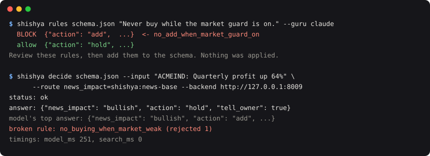

# Shishya decisions: the most likely answer that breaks no rule

A small library, separate from the [research](RESEARCH.md). Give it a model's probabilities and your rules, and it
returns **the most likely answer that breaks no rule** in milliseconds, or says it can't.

- **Never breaks a rule.** An exact best-first search. Every answer is checked before it comes back.
- **Learns from corrections.** `s.correct(decision, {...})`: one correction fixes that exact case. A small head learns the
  pattern, and is used only when it wins on held-out human labels.
- **Rules your way.** Plain English (drafted by an LLM, reviewed by you), JSON, Python or OPA/Rego.
- **Honest confidence.** Calibrate on your own labels and see how much you can automate, and with what error.
- **A Guru when unsure.** Hand the hard cases to a bigger model, still checked against your rules.

## Try it in 30 seconds

```bash
pip install shishya
git clone https://github.com/sanattaori/shishya && cd shishya
shishya decide examples/leave_request/schema.json --backend fake \
  --input "Need 5 days off next week for my sister's wedding" \
  --facts examples/leave_request/facts.json --rules examples/leave_request/rules.py --learner /tmp/leave
shishya correct /tmp/leave <decision id printed above> '{"verdict": "deny"}'    # it learns right away
```

<picture>
  <source media="(prefers-color-scheme: dark)" srcset="img/terminal-dark.svg">
  
</picture>

`--backend fake` uses made-up probabilities so you can see the mechanism. For real answers, point it at a decision model ([below](#use-a-real-model)).

## Results

- **Rule breaks:** 60 tasks (leave requests, stock alerts, shell commands). A small local model (Kev-0.8B) broke a
  rule 38% of the time; with Shishya, 0%, for 11 ms more. To be fair, a hand-written "check the rules, else return a
  safe default" gets close: 42/60 correct vs Shishya's 45/60
  ([why](../bench/RESULTS.md#4-against-the-simplest-alternative-rule-check--a-fixed-safe-default)). Learning is what
  should open that gap.
- **Learning:** on a synthetic test where the base model is always confidently wrong in one pattern, accuracy on
  requests it was never corrected on went from 46% to 94% after 40 corrections. Each correction is learned in
  1–30 ms on a laptop. Real data is noisier.

Every number, including where Shishya *doesn't* help yet: [bench/RESULTS.md](../bench/RESULTS.md)

## Use a real model

Any server speaking the System One decision API works, for example [Kev](https://github.com/jaredpalmer/kev) on a
laptop, or llama.cpp's `/v1/systemone`:

```bash
uv run --extra serve python -m kev.serve --run jaredpalmer/kev-0.8b --port 8009     # in the Kev repo

shishya decide examples/leave_request/schema.json --backend http://127.0.0.1:8009 \
  --input "Need 5 days off next week for my sister's wedding" \
  --facts examples/leave_request/facts.json --rules examples/leave_request/rules.py --learner ~/.shishya/leave
```

<details>
<summary><b>Python</b></summary>

```python
from shishya import Shishya, rule
from shishya.backends import SystemOneBackend

@rule(uses=["verdict"])
def within_balance(ans, ctx):
    "Leave can be approved only up to the remaining balance."
    f = ctx["facts"]
    return ans["verdict"] != "approve" or f["days_asked"] <= f["leave_balance"]

s = Shishya(SystemOneBackend("http://127.0.0.1:8009"), rules=[within_balance])
d = s.decide("Need 5 days off for my sister's wedding", schema, facts={"days_asked": 5, "leave_balance": 3})

d.status        # "ok" | "guru" | "unsure" | "none"
d.answer        # {"verdict": "hr_review", "urgent": False}
d.top           # the model's own top answer before the rules: {"verdict": "approve", ...}
d.confidence    # the weakest field's probability
d.receipt       # schema digest, rule fingerprints, model, timings: an audit trail
```
</details>

<details>
<summary><b>Rules: English, JSON, Python, Rego</b></summary>

**English → JSON** (drafted, never applied automatically):

```bash
shishya rules examples/stock_alert/schema.json "Never buy while the market guard is on." \
  --facts examples/stock_alert/facts.json --guru claude
```

**JSON** rules live in the schema under `x-shishya.rules`. They run no code, so they're safe to accept from anyone, including over HTTP:

```json
{"name": "no_buying_when_market_weak", "message": "Never buy while the market guard is on.",
 "forbid": {"all": [{"path": "answer.action", "eq": "add"}, {"path": "facts.market_guard_on", "eq": true}]}}
```

Operators: `eq neq gt gte lt lte in contains exists all any not`. Rules **fail closed**: `forbid` allows an answer only when its condition is definitely false, and `require` only when it is definitely true. If a fact a rule needs is missing or has the wrong type (`"5"` where a number is compared), the answers that rule might forbid are blocked, and `Decision.missing_facts` and `reasons` say why. Add `"on_missing": "allow"` to a `forbid` rule that should step aside instead. A Python rule that raises also blocks, and is listed in `Decision.rule_errors`.

**Python** rules name the fields they read, so a whole branch of answers is cut at once:

```python
@rule(uses=["action", "tell_owner"])
def owner_hears_about_sells(ans, ctx):
    "Any sell must be told to the owner."
    return ans["action"] != "trim" or ans["tell_owner"]
```

**Rego (OPA)**: the policy sees `input.answer` and `input.facts` and defines `allow` (plus `why_not` reasons). Network built-ins (`http.send`, …) are blocked. See [examples/shell_guard/policy.rego](../examples/shell_guard/policy.rego).

**Conditions** in the schema decide, without the model, which fields and options apply:

```json
"x-shishya": {"when": {"path": "facts.on_probation", "eq": true},
              "option_when": {"trim": {"path": "facts.owned_qty", "gt": 0}}}
```
</details>

<details>
<summary><b>Calibration: honest confidence</b></summary>

Decision models are often over- or under-confident. Label some real examples (JSONL: `{"input", "facts", "answer"}`), then:

```bash
shishya calibrate schema.json labels.jsonl --backend http://127.0.0.1:8009 --out calibration.json
shishya decide ... --calibration calibration.json --min-probability 0.9 --guru claude
```

It fits one temperature per field and reports, measured on held-out folds, how much you can automate at each confidence level and with what error. `min_probability` applies per field: every field must clear the bar.
</details>

<details>
<summary><b>The Guru</b></summary>

Below your confidence bar, Shishya can ask a bigger model. It's told which rules were broken, and its answer must pass the same rules.

```bash
shishya decide ... --min-probability 0.9 --guru claude       # your own Claude Code login (claude -p)
shishya decide ... --min-probability 0.9 --guru openrouter   # any OpenRouter model (OPENROUTER_API_KEY)
```

Guru answers come back with `trainable: false`, so Shishya never trains on them.
</details>

<details>
<summary><b>How it works</b></summary>

1. **Conditions** (plain code) remove fields and options the facts rule out.
2. **One model call** gives a probability for every allowed option of every field; `--route` sends a field to a local classifier.
3. **A\* search** over the fields. Priority is the probability so far × the best possible rest, so complete answers come out most-likely-first. Rules that name their fields prune whole branches; Rego checks batches of complete answers.
4. **Result:** `ok` (the best allowed answer), `unsure` (below `min_probability`, returned as `suggestion`), `guru`, or `none`.

Fields are scored independently given the input. That's what makes one call enough, and it's also the main limitation: rules couple fields, the model's probabilities don't.
</details>

<details>
<summary><b>HTTP server</b></summary>

```bash
pip install "shishya[server]"
shishya serve --backend http://127.0.0.1:8009 --port 8700
curl -s localhost:8700/v1/decide -d '{"input": "...", "schema": {...}, "facts": {...}, "rego": "package ..."}'
```

Over HTTP only JSON and Rego rules are accepted, never Python code.
</details>

## Credits

Shishya calls decision models over HTTP and includes none of their code. Thanks to [Kev](https://github.com/jaredpalmer/kev) and [jev-style](https://github.com/lawrence3699/jev-style) for open decision models; [SEntFiN](https://github.com/pyRis/SEntFiN) and [twitter-financial-news-sentiment](https://huggingface.co/datasets/zeroshot/twitter-financial-news-sentiment) for open human-labelled data; [ModernBERT](https://huggingface.co/answerdotai/ModernBERT-base); and [Open Policy Agent](https://www.openpolicyagent.org/).
