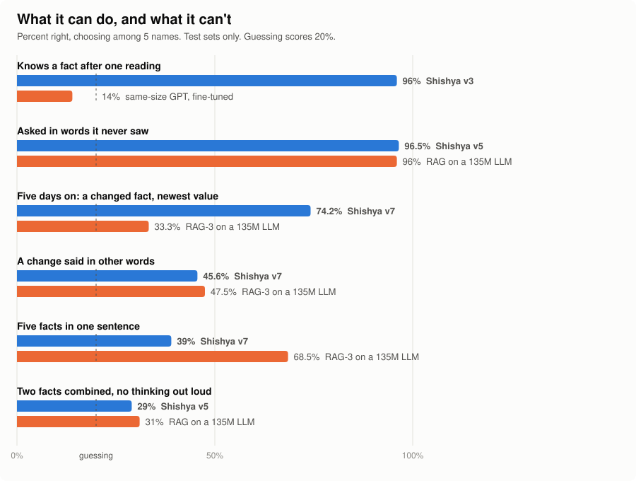

# Can a neural network keep learning after training, with no gradients?

*Sanat Taori. An open research log, October–November 2026. Free hardware only: a 4-core CPU and Kaggle's free GPUs.*

## Summary

We built a language model that learns after training by changing a lasting memory with a local rule. There are no
gradients, no optimiser, and no text kept beside it. We ran eight versions against tests whose pass rules were written
before each run, and we kept the failures on the record.

**What works.**
- It recalls a fact after one reading: 96%, where a same-size GPT fine-tuned on the same stream gets 14%.
- It recalls when asked in words it never saw, about kinds of facts it never trained on: 96.5%.
- It lived a five-day life, with its memory saved and reloaded each day, and ended with 88% of unchanged facts and 74%
  of changed facts at their newest value. RAG-3 on a small LLM got 33% on the changed ones.

**What doesn't.**
- A change in new words reaches the old fact only 46% of the time. RAG-3 gets 47.5%, a tie.
- Five facts in one sentence give 39%. RAG-3 gets 68.5%.
- It can't combine two facts unless it thinks out loud.
- Its memory is 268 MB, fixed. RAG's text is under 1 MB.
- It has only been tested on made-up names in simple sentences.

**Verdict.** The mechanism is real and well ahead of fine-tuning. It is not better than RAG overall, and it isn't ready
for real use. The latest full version, v7, failed three of its five rules.

We publish it because the mechanism is simple, the failures are specific, and the next experiments are clear.

## The question

Language models freeze when training ends. Fine-tuning on new text is slow and damages old knowledge. RAG works, but the
model itself learns nothing. Brains do something else: experience changes lasting connections, using local signals.

So we asked: **can a network learn a fact from one reading, by a local rule alone, and keep it for its whole life?**

We chose BDH, Pathway's brain-like language model, as the base, and added lasting synapses written by a surprise-weighted
delta rule. [ARCHITECTURE.md](ARCHITECTURE.md) explains how it works.

## How we kept it honest

- **Rules before runs.** Each version's plan, pass rules and predictions were committed before its first run. The
  commit history shows the order. If a rule failed by one question, it failed.
  Commit author names were made uniform once before release; contents and dates did not change.
- **Three sets of names.** Train names for childhood, dev names for choices, and test names used once. The world's facts
  use made-up names.
- **Kinds of fact and wordings held out.** Childhood trains on 26 kinds of fact (teacher, boat, song), and none are the
  five the tests ask about. Exam wordings are never used in training.
- **An outside examiner.** A separate free LLM wrote wordings for some of the exams.
- **Baselines in the same run.** Fine-tuning, RAG, exact look-up and no learning, on the same stream.
- **Harness checks.** For example, in the v8 tests a teacher that changes nothing had to land near the no-teacher control.

## The results

Test sets only, choosing among 5 names, so guessing scores 20%.

<picture>
  <source media="(prefers-color-scheme: dark)" srcset="img/research-dark.svg">
  
</picture>

| Test | Shishya | The other | Source |
|---|---:|---:|---|
| Knows a fact after one reading | 96% (v3, 12.8M) | 14% (same-size GPT, fine-tuned) | [RESULTS §6](../brain/RESULTS.md) |
| After three readings | 99% (v3, 12.8M) | 21% (GPT), 22% (BDH), fine-tuned | [RESULTS §6](../brain/RESULTS.md) |
| Asked in words it never saw | 96.5% (v5, 12.8M, no LLM) | 96% (RAG on SmolLM2-135M) | [V5](V5.md) |
| The outside examiner's wordings | 87% (v5, 12.8M, no LLM) | 74.5% (RAG on SmolLM2-135M) | [V5](V5.md) |
| Five days on: a changed fact, newest value | 74.2% (v7) | 33.3% (RAG-3 on SmolLM2-135M) | [V7](V7.md) |
| A change said in other words | 45.6% (v7) | 47.5% (RAG-3 on SmolLM2-135M) | [V7](V7.md) |
| Five facts in one sentence | 39% (v7) | 68.5% (RAG-3 on SmolLM2-135M) | [V7](V7.md) |
| Two facts combined, asked directly | 29% (v5, 135M) | 31% (RAG on SmolLM2-135M) | [V5](V5.md) |
| Two facts combined, thinking out loud | 94% (v5, 135M) | 89% (RAG on SmolLM2-135M) | [V5](V5.md) |

The five-day gain over RAG-3 has a 95% interval of +30 to +50.8 points. The tie on changes has −13.1 to +9.4.

Raw outputs are in [`brain/results/`](../brain/results/).

### Every version

| Version | The idea | Key numbers (test) | Rules | Verdict |
|---|---|---|---|---:|
| v1 | BDH + lasting synapses, delta rule | 35% after 3 readings, 24% after one | L1–L4 | FAIL (L1, L2, L4) |
| v2 | Learns to use the memory better | 67% after 3 readings; early facts fade | L1–L4 | FAIL (L1, L2, L4) |
| v3 | Address = the sentence's rare words | **99%, 96% after one**; other words 34% | L1–L4 | FAIL on speed only |
| v4 | Adds a meaning part and protection | 98%; held-out wordings 35% | L1–L5 | FAIL (L5) |
| Hybrid | v3's memory on a frozen LLM | 96%; other words 27% | H1–H5 | FAIL (H4, H5) |
| **v5** | **who × what address** | **Other words 89.5–96.5%** at 12.8M, 135M and 1.7B | V1–V5 | **PASS, all three sizes** |
| Hard school | New exam: changes, five facts in one sentence | v5 on 135M: changes 19%, one sentence 35.5% | D1–D4 | FAIL (v5 was never trained for this) |
| v6 | A childhood with changes; a 5-day life | Changes 49%, kept 65%, one sentence 34%; **life passes** | X1–X6 | FAIL (X1, X3, X4) |
| v7 | The 100M BDH reader; clause meaning; sleep | Changes 46%, kept 78%, one sentence 39%; **life passes** | Y1–Y5 | FAIL (Y1, Y2, Y3) |
| v8, in progress | Sharp read; a free LLM rewrites at the door | Changes 69%, kept 89%, one sentence 50% (12 people) | P1–P3 | FAIL by one question on P1, and on P3 |

The most useful row is v5's. Earlier versions failed on other wordings at 22–35%. Splitting the address into *who* and
*what* took that past 89%, at every size. Then the hard school showed that recall is the easy part.

### A side study: a self layer

A separate branch asked a different question: can 270 KB added to a frozen 1.7B LLM change how it behaves, with no prompt
text? ([lab/](../lab/)). It learned habits on its own: its name, short answers, asking back, saying "I don't know".

- Each single habit passed ([SELF_LAYER](../lab/SELF_LAYER.md)).
- On 200 real trivia questions it cut wrong answers from 99 to 35, but right answers fell from 98 to 59. That fails its
  rule ([KNOWING](../lab/KNOWING.md)).
- One layer holding several habits across a "life" failed, each time on one easy-facts question
  ([LIFE](../lab/LIFE.md)). Earlier habits stayed, the old name fell to 0% after a change of mind, and two copies grew
  different.

## What we learned

1. **A local rule beats fine-tuning at one-shot learning, by a wide margin.** 96% against 14% at the same size. This is
   the strongest result, and it held from v3 on.
2. **Where you write matters more than the network.** v2 and v3 are the same network. Changing only the address took
   recall from 67% to 99%, because same-kind facts went from sharing 61% of their address to 13%.
3. **Separate "who" from "what".** A name finds the place. A learned meaning finds the spot within it. This is what made
   other wordings work.
4. **A bigger reader was not the fix.** v7's 100M BDH tells kinds of fact apart far better than our 12.8M one (77% against
   45% on a probe), and yet changes didn't rise. The limit is in the memory.
5. **The wording gap causes most failed updates.** When a new value arrives in the same wording, the current value reaches
   92%, a ceiling measured on dev. In other words it is about 46%.
6. **A local rule replaces. Text doesn't.** The delta rule overwrites an old value, while RAG keeps old and new side by side
   and a small LLM often reads the wrong one. This is why the five-day life beats RAG-3 on changes. A larger LLM, or a
   look-up that prefers new sentences, may close this gap. We didn't test those here.
7. **Sleep, as built, trades new for old.** Replaying every trace kept unchanged facts at 86%, but brought old values back.
   The rule chose no sleep.
8. **Our guesses were often wrong, in both directions.** We predicted 45–65% for v5 on held-out wordings, and it scored
   98% at 1.7B. We expected separate memories to fix the table, and they lost on dev. Fixing the rules first is what makes
   these visible.

## Limits of this work

Read every number here with these in mind.

- **Made-up names, simple sentences.** Facts follow templates about people, inside children's stories. Real text is
  untested.
- **A choice among 5 names.** It is a clean measure, and an easier one than open answers. The demo writes open answers,
  which are noisier.
- **We wrote the tests.** The outside examiner helps, but the authors chose what gets tested.
- **The baselines are small.** RAG ran on 135M and 1.7B LLMs, and on hard tests only at 135M. Strong LLMs will do better.
- **Few seeds, small samples.** Each verdict is one test run. The v8 tests use 12 people, so only large gains count.
- **Memory is large and fixed.** 268 MB, about 800 times RAG's text in the long life.
- **Speed.** 231 ms per session on a GPU. v3 failed a 50 ms CPU rule, and from v4 on speed is reported, not ruled.
- **v8 is unfinished.** Its latest test was still running when this was written. See [V8_POC](V8_POC.md).

## Related work

- **BDH**, Pathway ([paper](https://arxiv.org/abs/2509.26507)). The base model. We use their code unchanged and test that
  ours matches.
- **Titans, ATLAS and Nested Learning**, Google
  ([blog](https://research.google/blog/introducing-nested-learning-a-new-ml-paradigm-for-continual-learning)). Memories
  updated at test time by surprise, close to our delta rule.
- **"Language Models Need Sleep"**, Google ([arXiv 2606.03979](https://arxiv.org/pdf/2606.03979)). Wake–sleep consolidation.
- **Sparse memory finetuning**, Meta ([arXiv 2510.15103](https://arxiv.org/abs/2510.15103)). Update only the slots a fact uses.
- **Larimar**, IBM ([code](https://github.com/IBM/larimar)). One-shot edits and forgetting, through an encoder and a memory
  written by least squares. It reports 83–88% on questions in other words. We tried local versions of its forgetting and
  protection in the early versions ([details](ARCHITECTURE.md#ideas-we-tried-from-larimar)).
- **The two-hop curse** ([arXiv 2411.16353](https://arxiv.org/abs/2411.16353)). LLMs too mostly fail to combine two separately
  learned facts without thinking out loud, as we found.

We don't claim this idea is new. Our contribution is an independent, open test, with the failures left in.

## Open problems

If you want to try something, these are the live questions. Each could be a small, well-defined experiment.

1. **Roles.** Give each kind of fact its own slot, so a change overwrites only its own. A first attempt on the *what*
   vector made things worse (never-changed fell to 35% on dev).
2. **The wording gap.** Make "moved to" land where "lives in" is asked, with no outside teacher.
3. **Telling a person's facts apart.** With one sentence and the teacher, 39 of 80 plain dev answers picked another fact
   of the same person, and none picked a stranger's.
4. **A sparse memory.** Store only what is used, in place of a fixed 268 MB.
5. **Real text.** Any test beyond made-up names.
6. **Combining facts,** without thinking out loud.

## Reproduce it

```bash
python -m brain.teach --tour                      # the demo, on a CPU
python -m pytest brain/tests -q                   # includes: our BDH matches Pathway's
python -m brain.longlife --help                   # the five-day life
brain/kaggle/run.sh YOUR_KAGGLE_USER --v7         # the full v7 run, about 6 hours on Kaggle's free GPUs
```

The 12.8M Brain checkpoint (70 MB) and the earlier readers aren't in git. `brain/kaggle/run.sh` rebuilds them. v7's reader
is in `brain/weights/`.

## Where to read more

- Each version's plan and results, in the order they happened: [PLAN](PLAN.md) (v1–v4) · [HYBRID](HYBRID.md) · [V5](V5.md) ·
  [V6](V6.md) · [V7](V7.md) · [V8_POC](V8_POC.md)
- Full tables for v1–v4: [brain/RESULTS.md](../brain/RESULTS.md)
- Why these steps, in this order: [ROADMAP](ROADMAP.md), [ROADMAP_V7](ROADMAP_V7.md)
